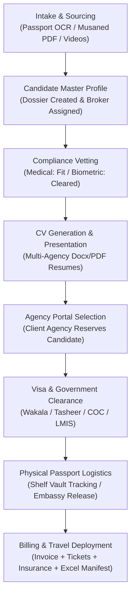

# System Overview & Feature Documentation: Overseas Recruitment & Manpower ERP

**System Identity:** DAERA / Coolstaff Agency Portal  
**Domain Classification:** International Manpower Recruitment & Staffing ERP / Overseas Employment Agency Management System (Gulf & Cross-Border Labor Deployment ATS/ERP)

---

## 1. Executive Summary & Purpose

The system is a specialized, multi-tenant Recruitment & Manpower Deployment ERP engineered for international recruitment agencies. It automates the full lifecycle of overseas labor sourcing, compliance vetting, client agency presentation, visa processing, document generation, physical passport inventory, and deployment logistics.

It specifically bridges source-country recruiting offices, field brokers/sub-agents, overseas employer agencies (e.g., in Saudi Arabia and Gulf regions), and government labor compliance systems (e.g., Musaned, Wakala, Tasheer, LMIS).

---

## 2. Core Functional Modules & Feature Overview

### Module 1: Fast Intake & Triage (Entry / Quick Registration)
* **Passport OCR & MRZ Scanner:** Automated extraction of candidate biographical data, passport numbers, dates of birth/issue/expiry, and nationality from passport photos via client-side OCR and MRZ (Machine Readable Zone) regex parsers.
* **Musaned PDF Auto-Parser:** Automated parsing of standardized government recruitment CVs (Musaned format) extracting work history, languages, religion, and family details.
* **Staging & Promotion Pipeline:** Temporary walk-in triage queue allowing staff to review and promote verified records directly into the master candidate database.

### Module 2: Master Candidate Management (ATS & Profiling)
* **Comprehensive Digital Dossier:** Centralized profile storing biometrics, travel credentials, education, multi-language proficiencies, categorized work history, contact information, and relative emergency contacts.
* **Document & Media Vault:** Cloud and local storage for passports, face photos, full-body portraits, ID scans, Certificates of Competence (COC), and medical reports.
* **Quarantine & Risk Flagging:** Candidate flagging mechanism to freeze or blacklist problematic profiles across the recruitment pipeline.

### Module 3: Compliance & Medical Clearance
* **Medical Vetting Tracker:** Multi-state medical status workflow (`Pending`, `Fit`, `Unfit`) with test dates and medical condition logs.
* **Biometric Clearance Tracker:** Recording biometric capture dates and embassy clearance states.
* **"Fit Candidates" Pool:** Dedicated pipeline view filtering only medically and biometrically cleared candidates ready for client selection.

### Module 4: Dynamic CV & Document Generation Engine
* **Multi-Agency Template Generator:** Automated generation of branded corporate resumes in Microsoft Word (`.docx`), PDF, and JPG formats.
* **Pre-Engineered Agency Templates:** Specialized layouts matching client agency formats (ALM, Almala, KA-7, KU2, MA, RA, Al-Shablan, Ussus, Vision).
* **Automated QR Code & Media Injection:** Injects dynamic QR verification codes, embedded portrait/full-body photos, and structured data tables into generated CVs.
* **Print & Export Studio:** Dedicated browser print layouts and zip-compressed bulk CV download workers.

### Module 5: Video Interviews & Media Management
* **Candidate Video Hub:** Support for uploading MP4 introduction videos, YouTube video links, and photography assets.
* **Pre-Registration Video Staging:** Allows field agents to record and submit video interviews by passport number before the full candidate profile is entered into the system.
* **Video Showcase Library:** Interactive gallery for recruiting staff and client agencies to evaluate candidates remotely.

### Module 6: Partner Agency Portal (Multi-Tenant B2B Portal)
* **Agency-Specific Restricted Views:** Tailored portals for overseas client agencies, filtered by authorized agency codes and allowed candidate pools.
* **Candidate Reservation & Request:** Real-time candidate selection and visa reservation workflow (`Private` or `Agency` allocations).
* **Agency Contract & Visa Status Dashboard:** Live tracking of visa status, Wakala (sponsorship authorization), Tasheer (visa stamping center), and embassy progress.

### Module 7: Visa Processing & Government Clearances
* **Visa Allocation Tracking:** Assignment of visa numbers, contract numbers, and sponsor allocations.
* **Middle East Labor Workflow Milestones:**
  * **Wakala Status:** Electronic power of attorney / authorization payment tracking (`Paid` / `Unpaid`).
  * **Tasheer Status:** Visa service center appointment and biometric submission tracking.
  * **COC Status:** Certificate of Competence verification.
  * **Embassy Issue Tracking:** Exception handling for visa rejection or embassy holds.
  * **QR Code & LMIS Validation:** Tracking Labor Market Information System QR authorizations.

### Module 8: Physical Passport Vault & Shelf Inventory
* **Cabinet & Shelf Numbering:** Automated sequential shelf slot assignment (e.g., Shelf 001, 002) for tracking physical passport documents.
* **Check-out / Check-in Logs:** Audit log recording passport status (`Available` vs. `Taken`), borrower name, phone number, checkout date, and checkout reason (e.g., embassy submission, medical center).
* **Physical Asset Reconciliation:** Quick lookup matching physical shelves to digital candidate profiles.

### Module 9: Invoicing & Deployment Packages
* **Candidate Billing:** Invoicing engine linking candidate placement costs, agency fees, and price schedules.
* **Deployment Travel Packs:** Consolidation of mandatory travel documentation:
  * LMIS authorization QR code.
  * Health and labor insurance policy certificate.
  * Electronic flight ticket stubs.
* **Delivery & Travel Scheduling:** Logging departure dates, flight schedules, and delivery handoffs.

### Module 10: Logistics & Candidate Deployment Management
* **Flight Manifest & Deployment Calendar:** Overview of candidates cleared for travel with confirmed flight dates.
* **Excel Data Export:** Automated generation of Excel spreadsheets (`.xlsx`) formatted for airport escorts, embassy reporting, and client agency manifests.

### Module 11: Sourcing Network & Broker Hierarchy
* **Sub-Agent / Broker Directory:** Sourcing agent tracking attributing every candidate to their originating broker.
* **Leader Hierarchy Management:** Grouping brokers under administrative regional leadership hubs (e.g., DAERA Office 1 vs. Office 2).
* **Broker Lockout Controls:** One-click suspension of brokers to freeze submissions from non-compliant sources.

### Module 12: Administration, Security & Automation
* **Role-Based Access Control (RBAC):** Multi-tiered roles (`super_admin`, `admin`, `agency`, `user`) with dynamic route permission editing stored in the database.
* **Automated Telegram Bot Alerts:** Scheduled cron monitoring candidate deadlines (e.g., 30-day CV submission limits) with automated push alerts to Telegram channels.
* **CV Backup & Archival Vault:** Dedicated backup repository to restore, re-template, or download previously issued resumes.
* **Dynamic Template Pricing:** Administrative price configuration per CV template format.

---

## 3. End-to-End System Workflow

---

## 4. Technology Stack Overview

| Layer | Technologies Used |
| :--- | :--- |
| **Frontend** | Next.js 15 (App Router), React 19, TypeScript, Tailwind CSS v4, Lucide Icons, TanStack Query |
| **Backend** | Node.js, Express.js, TypeScript, REST API Architecture |
| **Database & ORM** | MySQL, Drizzle ORM (schema relations, indexes, migrations) |
| **Authentication** | Better Auth (session-based authentication, RBAC, encrypted tokens) |
| **Document Engine** | Docxtemplater, PizZip, Mammoth, Playwright (Chromium rendering), ExcelJS, jsPDF |
| **Parsing & OCR** | Tesseract.js (OCR), MRZ regex parser, pdf-parse (Musaned documents) |
| **External & Cloud Services** | Cloudinary / local storage, Telegram Bot API (deadlines alert bot), QRCode generator |

---

## 5. ChatGPT Search Prompts & Benchmark Projects

When searching for similar open-source projects or ready-made software templates using ChatGPT, the following classifications, keywords, and reference architectures apply:

### Primary Search Keywords & Categories
* **Industry Terms:** *"Overseas Recruitment Agency ERP"*, *"Manpower Sourcing & Deployment Management System"*, *"Foreign Employment Agency Software"*, *"Gulf Recruitment Portal (Musaned / Wakala / Tasheer)"*, *"International Labor Mobility CRM"*.
* **Functional Keywords:** *"Applicant Tracking System with Document Generation"*, *"Passport MRZ OCR recruitment software"*, *"Multi-tenant agency placement portal"*, *"Physical passport inventory management software"*.

### Close Open-Source & Commercial Benchmarks
1. **ERPNext / Frappe HR:** Highly customizable open-source ERP with extensive recruitment, applicant tracking, custom DocType generation, and document attachment workflows.
2. **OpenCATS:** Open-source Applicant Tracking System dedicated to staffing agencies.
3. **Odoo Community (Recruitment + Invoicing + Documents modules):** Open-source modular ERP easily adapted for recruitment, pipeline stages, billing, and document templates.
4. **Custom Staffing ERPs (Commercial Equivalents):** *Musaned Integrated Agency Systems*, *RecruitCRM*, *Manatal*, or specialized Middle East recruitment agency software (e.g., *Saffar*, *JobEx Agency ERP*).

